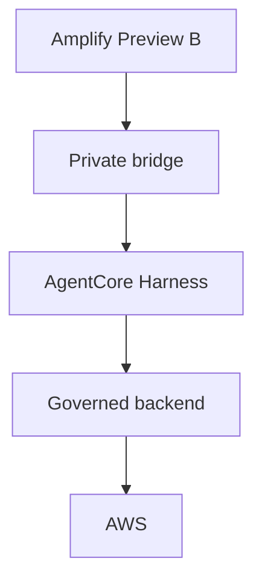

# Two separate surfaces

The Site runs in the browser: generated synthetic records, filter/selection,
deterministic context, frozen proposal, one consumed decision and simulated
evidence. It contains no AWS client, bridge, model or backend implementation.
`connect-src 'none'` denies application connection requests. Reset/reload
restores in-memory data; no browser storage or credentials are required.

The **separate engineering application** has this explanatory architecture:

The Harness investigates through registered tools. The governed backend owns
target checks, fixed capabilities and explicit single-use approval. Provider
readback and compliance evaluation are different observations. This Site only
explains that architecture; no arrow represents a connection from the Site.

## Simulated authority

Selection → compatible scope → immutable exact-target proposal → Approve Once
or Reject → evidence. Commands change filters/selection only. The assistant
cannot approve, expand a frozen target set or run arbitrary commands.

Rejection records zero writes for every target and skips readback/evaluation.
Approval changes only invented in-memory records. Optional blocked targets
fail before writing and remain NON_COMPLIANT. VERIFIED / PARTIAL / REJECTED
are mock outcomes, never evidence of an AWS write or Config convergence.
Evidence replay cannot execute. Switching filters/context invalidates pending
authority; existing run evidence remains explicitly scoped to its own targets.

The separate engineering demo is an ordinary explicit navigation link.
It may require private operator setup to use LIVE LAB. The Site never embeds,
prefetches or calls it. No bridge address, token or deployment identity is copied
into this portable package.

## Operations Campaign (Issue29)

The campaign derives inventory totals and four 25-target queues from the existing
synthetic records. Open/Preview uses the same selection, scope, proposal, human
decision and fixed-tool executor. A queue is never approval for another queue.

The session journal copies and freezes recorded runs at the evidence boundary.
Identity is inventory epoch + run ID + proposal ID. Up to 12 recent records survive
inventory reset in memory; reload clears them. Only the current interrupted run
can resume through its existing consumed proposal. Final snapshots never change
when another finding/run is selected. No new persistence or transport exists.

Selected complete snapshots feed both audit formats through the existing Blob
export mechanism. Counts distinguish evaluations from unique targets within each
epoch, and unresolved from verified evaluations. Provider readback and compliance
remain separate; no incident record is inferred or attached. An incomplete record
cannot be selected for the final packet. Historical proof files retain their own
source digests and do not verify the campaign release.

## Offline Shift Review Desk (Issue31)

Explicit local file → bounded parser → strict synthetic v1 contract validation
→ frozen original packet + exact evaluation index → separate operator-note Map
→ source-linked review overlay. No edge connects imported data to campaign
selection, proposal, executor, inventory or incident closure. The source release
and fingerprint are declarations only; consistency checks do not authenticate them.

Limits are 2 MiB, 12 runs, 2,000 evaluations; every nested contract object uses an
allowlist, terminal results/counters/identities are reconciled, and all display
text is bounded. Complete VERIFIED target evidence is checked even within PARTIAL
runs. Exact JSON overlay includes the unchanged original packet; Markdown escapes
untrusted text and includes only explicitly selected evidence plus honest totals.

Notes use the full epoch/run/proposal/target tuple (validated identifiers cannot
contain delimiters). Import admission uses a monotonically increasing token so
clear/replacement invalidates pending reads. No persistence or remote API exists.

## Next-Shift Review Continuation (Issue33)

Separate bounded local overlay input → strict v1 overlay + embedded original
validation → staged admission preview → explicit continuation → same isolated
review desk. Prior annotations are copied into a current-note Map and referenced
by an immutable baseline Map; editing replaces the current note, never its baseline
or original evidence. Progress/filtering is a session comparison only.

All selected identities/revisions/targets/results must exactly match the original
validated unresolved evaluation. Omitted annotations cannot be reconstructed from
a count. The old format's aggregate omitted-note count is checked for feasibility
and labelled self-reported/unavailable. Current export remains flat v1, derived
from available notes and explicit selection, with an excluded-note warning. No
nested history, new backend, storage or executor edge is introduced.
